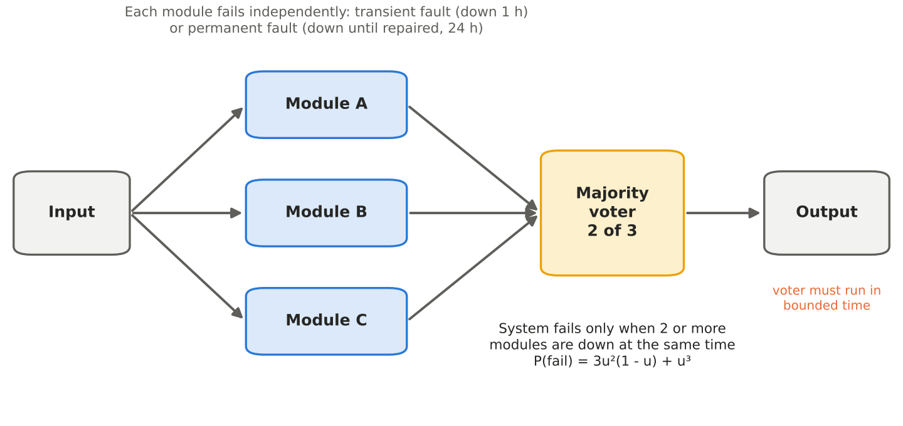
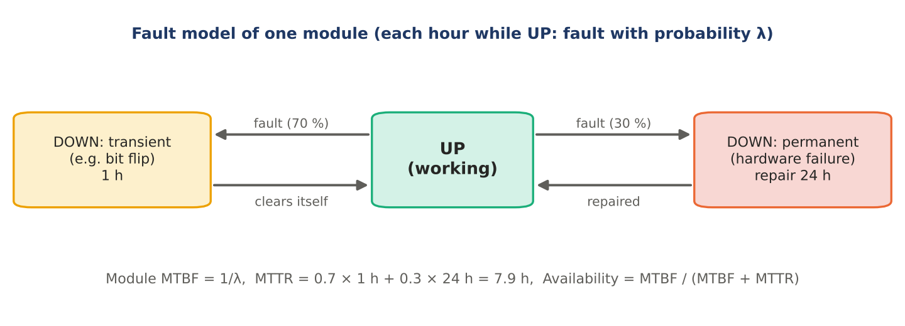
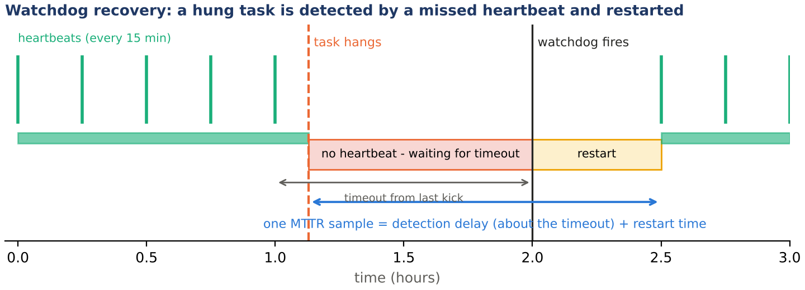
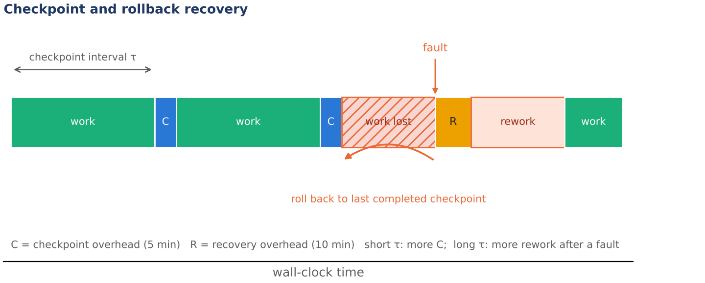

# Real-Time Systems – Unit 5 Lab (Mini Projects 5.1 – 5.3)

University of Rwanda, Gako Campus · Computer Engineering · Year 4 · Group assignment

| Member | Reg. No. |
|---|---|
| Janvier NSHIMIYIMANA | 223026679 |
| Blandon ASHIMIRWE | 223026675 |
| Gilbert HIRWA NTWALI | 223026689 |

The full written report (Word) is submitted separately. This repository holds the code and the generated outputs.

## Contents

| Folder | Mini project | What it does |
|---|---|---|
| `mp5_1_tmr_watchdog/reliability_sim.py` | 5.1 | Simplex vs TMR with transient and permanent faults, empirical vs analytical MTBF and availability, watchdog recovery, and the four lab tasks |
| `mp5_2_monte_carlo_nmr/monte_carlo_nmr.py` | 5.2 | Monte Carlo sweep of failure rate (1e-4 to 1e-2 per hour) for simplex, TMR, 5MR and 7MR with 95 % confidence intervals and a CSV export |
| `mp5_3_checkpoint_rollback/checkpoint_sim.py` | 5.3 | Checkpoint/rollback simulator, checkpoint-interval sweep for four MTBF values, analytical optimum (Young and renewal model) |
| `outputs/` | all | Console logs, CSV results and plots |

## How to run

Python 3.8 or newer. Only the **standard library** is needed; if `matplotlib` is installed the scripts also save PNG plots.

Windows: double-click `run_all.bat` (takes under a minute).
Linux/macOS: `./run_all.sh`

Each script can also be run on its own, and accepts `--quick` for a faster, smaller run:

```
python mp5_2_monte_carlo_nmr\monte_carlo_nmr.py --quick
```

All random number generators use fixed seeds, so the results repeat exactly.

## Diagrams

| | |
|---|---|
|  |  |
| 5.1: TMR with a 2-of-3 majority voter | 5.1: transient and permanent fault model |
|  |  |
| 5.1: watchdog detection and restart | 5.3: checkpoint and rollback recovery |
